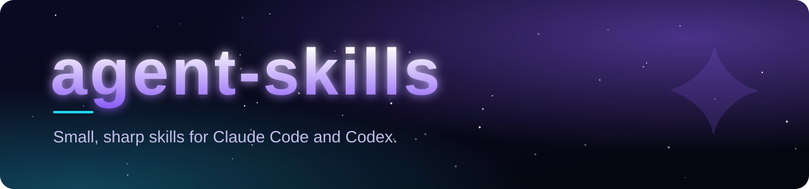

<p align="center">
  
</p>

<p align="center">
  
  
  
  <a href="https://github.com/Vortexyyy/agent-skills/stargazers"></a>
</p>

<h3 align="center">Five small, sharp skills that make Claude Code and Codex safer, faster and more honest.</h3>

<p align="center"><b>⭐ Useful? <a href="https://github.com/Vortexyyy/agent-skills/stargazers">Drop a star</a>. It helps other people find these. ⭐</b></p>

---

## 🧰 The skills

| Skill | What it does | Use it when |
| --- | --- | --- |
| 🔒 **[publish-safety-audit](skills/publish-safety-audit/SKILL.md)** | Scans the tree, the full git history, binaries and screenshots for secrets and personal data, then reports before anything goes public. | You are about to make a repo public or share code. |
| ✨ **[repo-glow-up](skills/repo-glow-up/SKILL.md)** | Banner, badges, screenshots, a clear README, topics and a star call to action, with metadata stripped and links checked. | You want a repo to look great and be easy to adopt. |
| 📏 **[measure-first](skills/measure-first/SKILL.md)** | Baseline, audit, fix, re-measure, honest before/after report. No gain counts if it is inside the noise. | Anything needs to be faster, lighter or smoother. |
| ✅ **[verify-before-done](skills/verify-before-done/SKILL.md)** | Build, test, run and look before saying "done". Reports what was and was not verified. | The end of any task, or after subagents hand work back. |
| 🧭 **[session-handoff](skills/session-handoff/SKILL.md)** | Writes a short, secret-free handoff note so a fresh session or another tool can continue instantly. | Context is long, you are stopping, or switching between Claude Code and Codex. |

Looking for model routing? See [model-router](https://github.com/Vortexyyy/model-router-skill) and [opus-sonnet](https://github.com/Vortexyyy/opus-sonnet-skill).

## 📥 Install

```bash
git clone https://github.com/Vortexyyy/agent-skills
cd agent-skills
./install.sh            # both Claude Code and Codex
./install.sh claude     # only ~/.claude/skills
./install.sh codex      # only ~/.codex/skills
```

Or copy any folder from `skills/` into `~/.claude/skills/` or `~/.codex/skills/` by hand. Start a new session afterwards. Each skill is a single `SKILL.md` with a `name` and `description`, so any agent that supports the format can use it, and the description tells the agent when to apply it.

## 🧪 How they are meant to be used

- Skills **guide** the agent; they do not replace your judgement. Read what the agent reports.
- They never publish, push or delete on their own: outward-facing steps stay behind your confirmation.
- Edit the `SKILL.md` files freely. They are plain Markdown.

## 💜 Support

- ⭐ **[Star this repo](https://github.com/Vortexyyy/agent-skills/stargazers)** so more people can find it.
- 🐛 **[Open an issue](https://github.com/Vortexyyy/agent-skills/issues)** with a skill idea or a fix.
- 📣 Share it with someone who uses coding agents.

<p align="center">
  <a href="https://github.com/Vortexyyy/agent-skills/stargazers"></a>
</p>

<p align="center"><sub>MIT licensed. Not affiliated with Anthropic or OpenAI.</sub></p>
